<p align="center">
  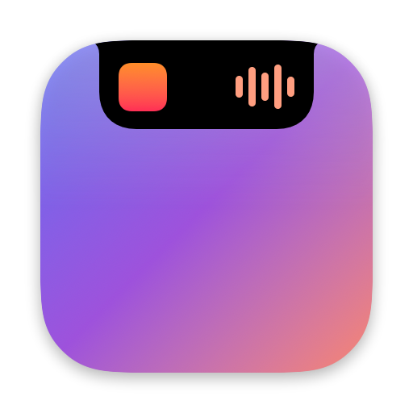
</p>

<h1 align="center">Islet</h1>

<p align="center">
  <strong>The Dynamic Island. Reimagined for the Mac.</strong><br>
  Your music, your calls, Claude, your day and your system. Alive in the notch.
</p>

<p align="center">
  <a href="https://github.com/tdecort/Islet/stargazers"></a>
</p>

<p align="center">
  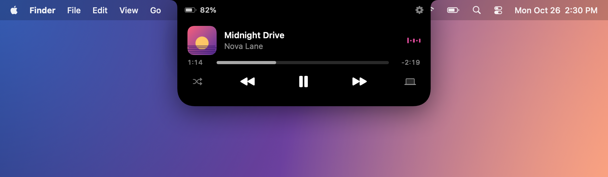
  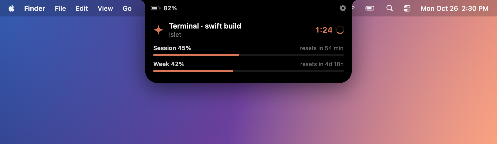
</p>

---

## Meet Islet

That black notch at the top of your MacBook has always just been there. Islet gives it a purpose.

Islet turns the notch into a living surface that shows what matters, exactly when it matters: the song you're playing, the call you're on, what Claude is working on, your next meeting, a file you want to keep at hand. Then it gets out of the way.

Every expansion, every collapse and every transition is driven by spring physics tuned to feel like the Dynamic Island on iPhone. Nothing pops. Nothing jumps. It simply flows.

## Feel

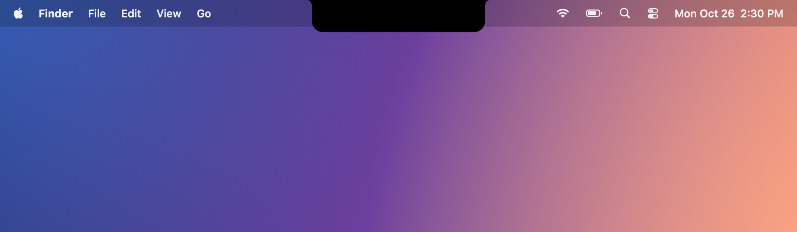

Hover over the notch and the island swells, then settles back with a gentle bounce, just like tapping an empty Dynamic Island on iPhone. It is Islet's way of saying *nothing's going on right now*.

Islet measures the real notch of your Mac every time it launches, so it fits a MacBook Air and a MacBook Pro alike.

## Now Playing


Album art on one side of the camera, a live visualizer tinted with the artwork's colors on the other.


Click to open a full player: scrub through the track, play, pause, skip, shuffle.

- **Apple Music, Spotify and YouTube** in your browser, complete with the video's thumbnail.
- When Spotify and a video play at the same time, Spotify takes the lead.
- Click the player to jump straight to the app that's playing.

## Claude, live in your notch

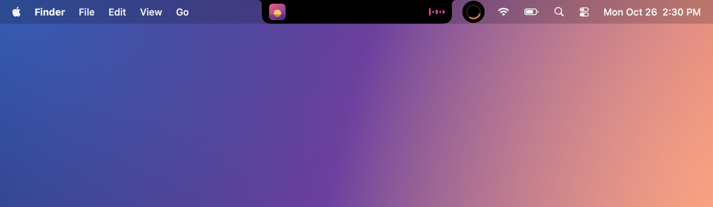

When Claude Code is working, a progress bubble appears right next to whatever is already in your island. Two live activities, side by side, just like on iPhone.


Open it to see exactly what Claude is doing, whether it's thinking, running a terminal command or editing a file. You also see how long it has been at it, and where you stand on your session and weekly limits.

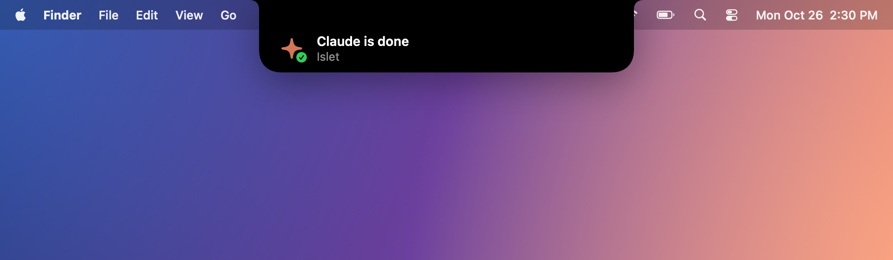
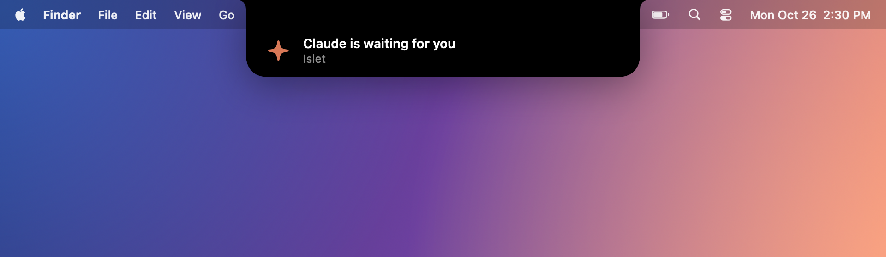

Working in another app? Islet tells you the moment Claude is done, or when it's waiting for your answer. Stop babysitting the terminal.

## Calls

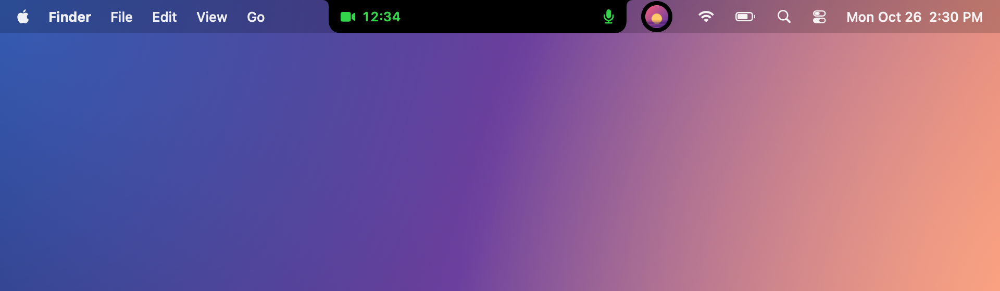

On a call in FaceTime, Zoom, Teams, WhatsApp, Discord, Slack or Skype, the duration and your microphone status stay in view.

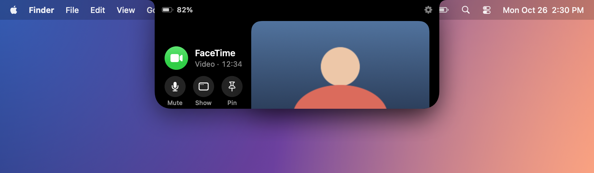

Click to see the other person's video, with a real **Mute** button that silences your microphone. No hunting for the call window.

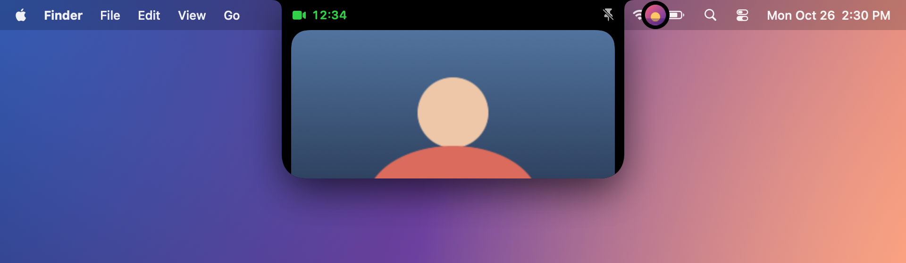

**Pin the video**, and it stays in your notch while you work in any other app.

## Volume and brightness, reinvented

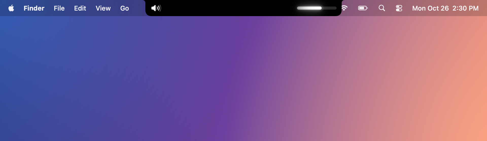
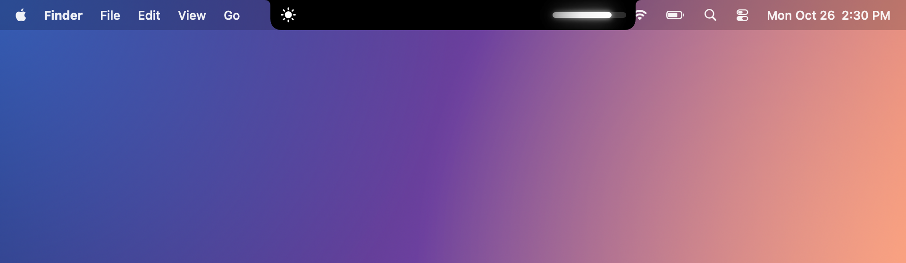

Your volume and brightness keys light up the notch instead of the macOS overlay. Pick your look: White, Accent or **Glow**.

## Focus and Do Not Disturb


Turn on a Focus and its symbol lights up in its own color. Turn it off and it fades to gray. Do Not Disturb, Work, Sleep, or any Focus you've made.

## Devices and battery

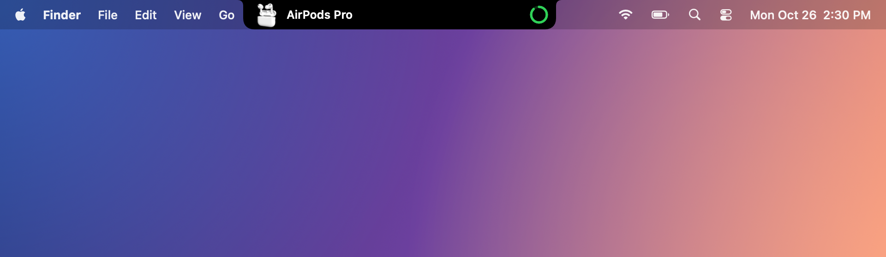

Your AirPods connect, and the island shows it, battery level included.

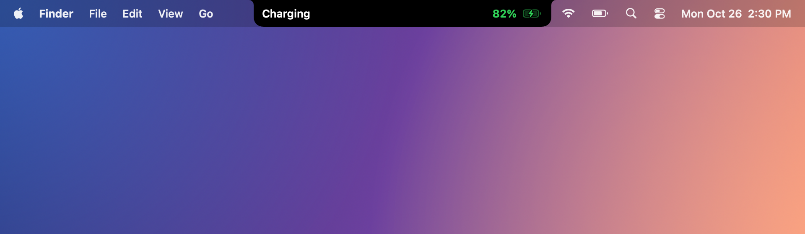
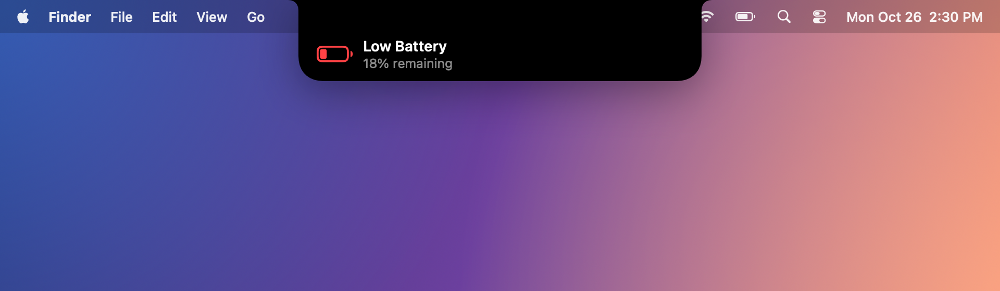

Charger plugged in, battery running low, Low Power Mode on: the essentials, at the right moment.


And a little lock that springs open when you unlock your Mac.

## Your day

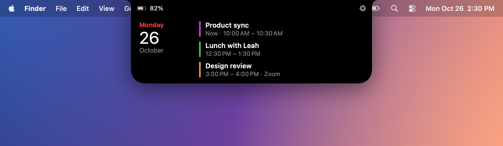

Your next meetings, at a glance.

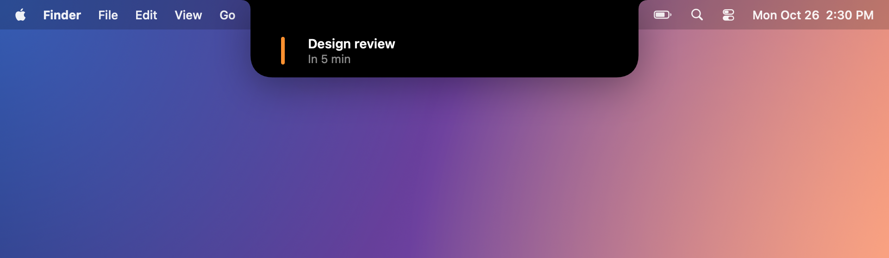

A gentle heads-up a few minutes before each event starts.

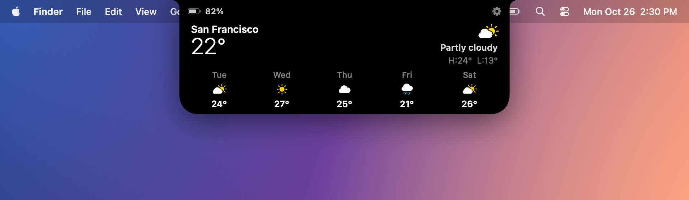

Today's weather and the next five days, for where you are or any city you choose.

## Focus timer


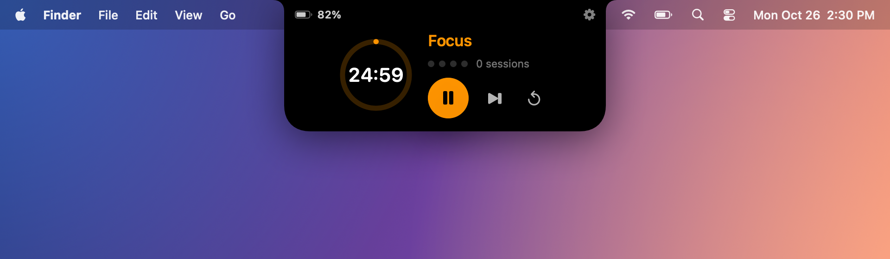

A Pomodoro-style timer that lives in your notch. Click the time and type any length you like. When it ends, the iPhone timer ringtone plays until you touch the island. Focus sessions and breaks chain on their own.

## Drag, drop, share

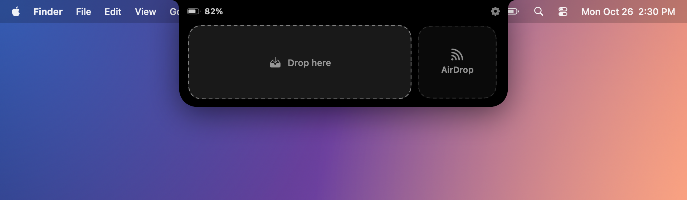

Drag a file toward the notch and it opens up to welcome it.

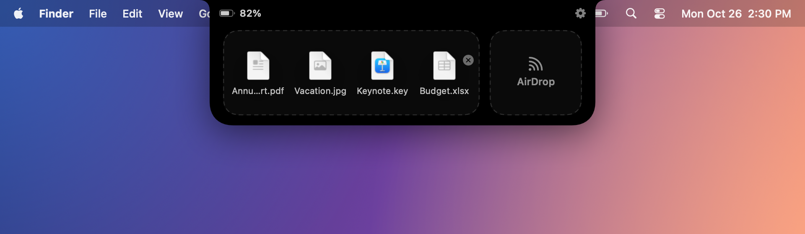

Keep files on **the Shelf**, ready to drag back out whenever you need them. Or drop them on **AirDrop** to send them on their way.

## Everything, without opening anything

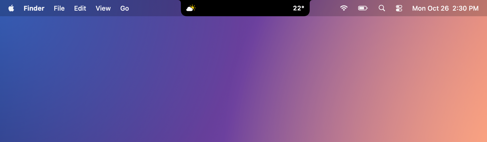

Hover the island and swipe with two fingers: call, music, Claude, calendar, weather, timer and Shelf glide by in compact form. The island always takes exactly the space its content needs. Nothing more.

## For Macs without a notch

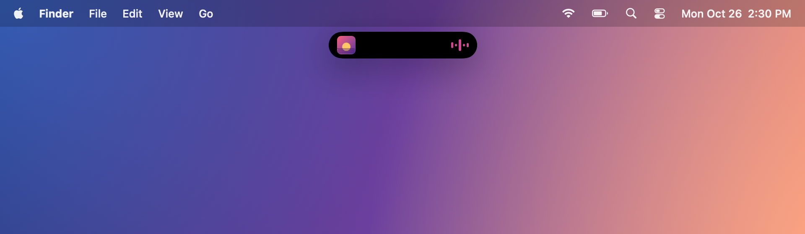
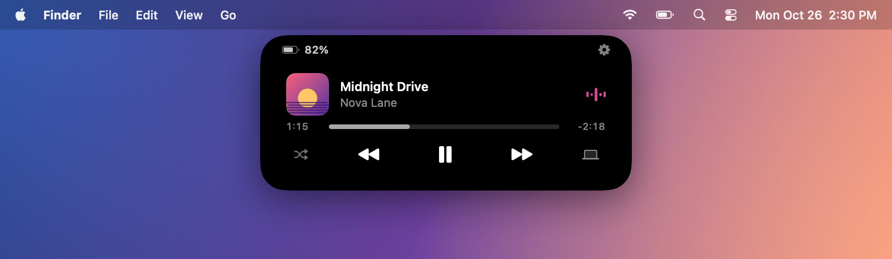

On an external display or a Mac without a notch, Islet becomes a floating island just below the menu bar, like on iPhone. Choose the style you love: Notch, Island or Automatic.

## Designed for macOS

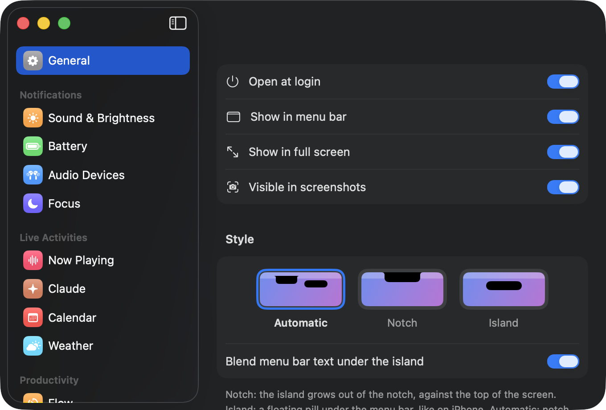

- **Settings that feel like System Settings**, including a single page that gathers every permission and its status.
- **Native and featherweight.** A 4.5 MB Mac app written in Swift, using about 70 MB of memory and 0% CPU when idle.
- **Private by design.** Islet collects no data. No analytics, no account.
- **One click away.** Click any expanded view to open the app behind it: Music, Calendar, Weather, FaceTime, Claude…

---

## Installation

### Requirements

- A Mac running macOS 14 Sonoma or later. Islet was built and tested on a MacBook Air with M4, running macOS 26.
- Apple's Command Line Tools, which include Swift. If you don't have them yet:

```bash
xcode-select --install
```

### Build and install

Get the code:

```bash
git clone https://github.com/tdecort/Islet.git && cd Islet
```

Build the app:

```bash
scripts/build-app.sh
```

This creates `build/Islet.app`. Move it to your Applications folder, then open it:

```bash
mv build/Islet.app /Applications/ && open /Applications/Islet.app
```

Islet lives in your notch and in the menu bar. It never shows up in the Dock. To have it start with your Mac, turn on **Settings › General › Open at login**.

### First launch: permissions

> [!IMPORTANT]
> **Islet asks for several macOS permissions. Say yes to each of them, and whenever macOS offers *Always Allow*, choose *Always Allow*.**
>
> Each permission unlocks one feature, and macOS asks for each one separately: no app can request them all at once. If you pick *Allow* instead of *Always Allow* where both are offered, macOS will keep asking you again and again.

Every permission, and why it's there:

| Permission | What it unlocks | How macOS asks | What to do |
|---|---|---|---|
| **Accessibility** | Replaces the macOS volume and brightness overlay with Islet's, and keeps the call window visible so its video can appear in the island. | A dialog sends you to System Settings › Privacy & Security › Accessibility. | Turn **Islet** on. |
| **Screen Recording** | Shows the other person's video from your call inside the island. Islet only ever captures the call window, and only while that video is showing in the island. | A dialog, then a switch in System Settings › Privacy & Security › Screen & System Audio Recording. | Turn **Islet** on, then quit and reopen Islet. macOS applies this one only after a relaunch. |
| **Calendar** | Your upcoming events and the reminders before they start. | A dialog the first time you open the Calendar view. | **Allow Full Access**. |
| **Location** | Local weather. Prefer not to share it? Type a city in Settings › Weather instead. | A dialog the first time you open the Weather view. | **Allow**. |
| **Bluetooth** | AirPods and other device connections, with battery levels. | A dialog at first launch. | **Allow**. |
| **Automation** | Reads and controls what's playing in Music and Spotify. | A dialog for each app, the first time it plays. | **OK**. |
| **Full Disk Access** | Focus and Do Not Disturb. macOS keeps the Focus status in a protected folder, and this is the only way to read it. | Nothing pops up: add Islet yourself in System Settings › Privacy & Security › Full Disk Access. | Click **+**, choose Islet, turn it on. |
| **Keychain** *(Claude only)* | Your Claude usage limits when Claude Code's status line can't provide them. Islet reads the sign-in token Claude Code already saved, and uses it for nothing else. | "Islet wants to use your confidential information stored in *Claude Code-credentials*." | Enter your Mac password, then click **Always Allow**. |

You can check and grant all of them in one place: **Settings › Permissions**. Each **Allow…** button starts from a clean slate and asks again, exactly as on a first launch.

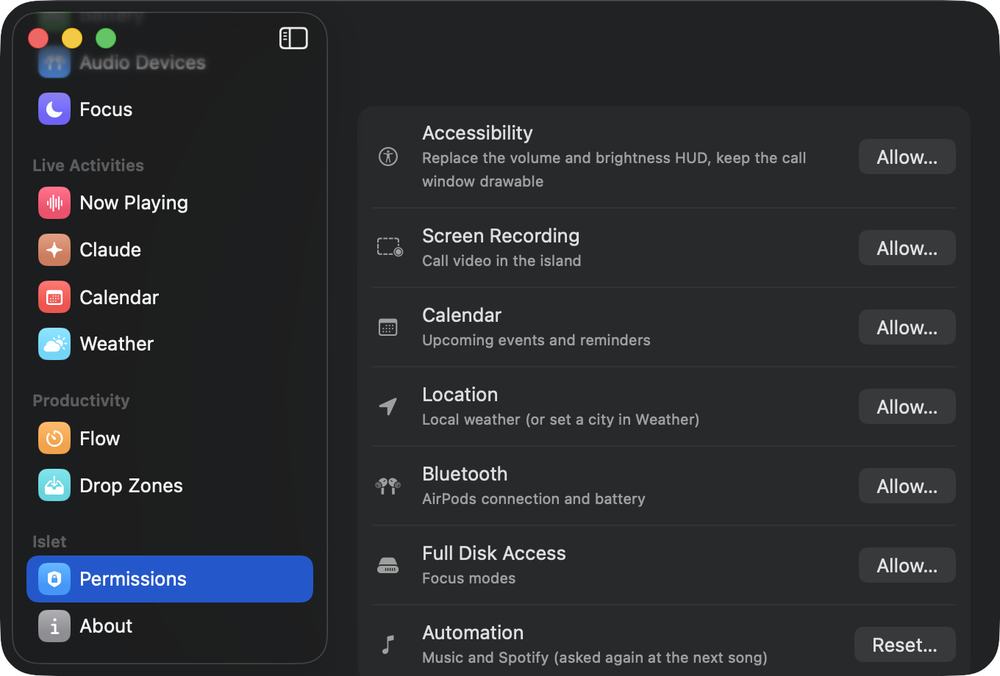

> [!NOTE]
> Islet is built on your Mac rather than signed by a registered Apple developer. Because of that, when you rebuild Islet after an update, macOS may forget its Accessibility and Screen Recording permissions, even if Islet still looks enabled in System Settings. If the volume overlay appears twice, open **Settings › Permissions** and click **Allow…** next to Accessibility.

### Connect Claude Code

1. Open **Settings › Claude** and click **Install**.
2. Restart Claude Code.

Islet adds a few hooks and a status line to `~/.claude/settings.json` so Claude Code can tell Islet what it is doing and how much of your limits you've used. Your other settings are left untouched, and a backup is saved next to the file. One click on **Remove** takes it all back out.

## Gestures

| Gesture | What happens |
|---|---|
| Hover the notch | The island bounces when nothing is running, or lifts slightly when something is. |
| Click | Opens the activity on screen, or your dashboard. |
| Two-finger swipe ← → | Switches between activities and views. |
| Two-finger swipe ↓ / ↑ | Opens / closes the island. |
| Drag a file to the notch | Opens the Shelf and AirDrop. |
| Click the side bubble | Brings the second activity to the front. |

## Privacy

Islet collects nothing and has no account. It only talks to the internet to:

- fetch the weather from [Open-Meteo](https://open-meteo.com), when the Weather view is open;
- look up a YouTube video's thumbnail from its title, and download Spotify artwork;
- read your Claude usage from Anthropic, using the token Claude Code already has, when Claude Code's status line can't provide it.

## Known limits

- The macOS Do Not Disturb key still shows its own overlay alongside Islet's.
- Islet does not appear on the lock screen.
- YouTube and other browser media rely on what the browser reports to macOS; Firefox, for one, sends no artwork, which is why Islet looks up the thumbnail itself.
- Call detection was tested with FaceTime.

## For developers

Islet is written in Swift, SwiftUI and AppKit, with no third-party dependencies.

```bash
scripts/test.sh                                              # run the test suite
build/Islet.app/Contents/MacOS/Islet --marketing docs/images # regenerate the images in this README
```

---

<h2 align="center">⭐ Love Islet? Give it a star.</h2>

<p align="center">
  If Islet made your notch worth looking at, a star takes one click.<br>
  It helps more Mac users discover Islet, and it tells us what to build next.
</p>

<p align="center">
  <a href="https://github.com/tdecort/Islet/stargazers"></a>
</p>
