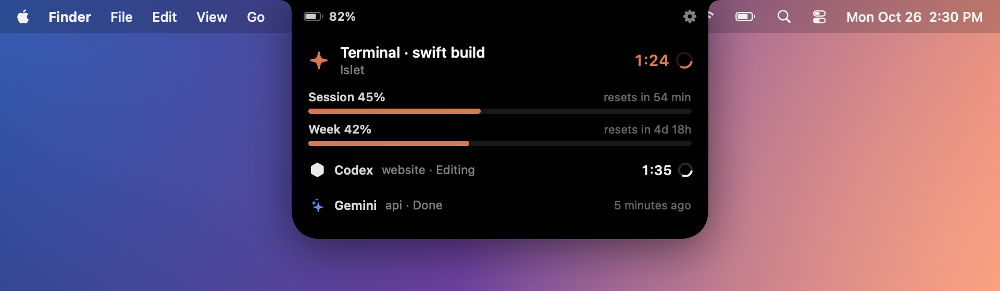
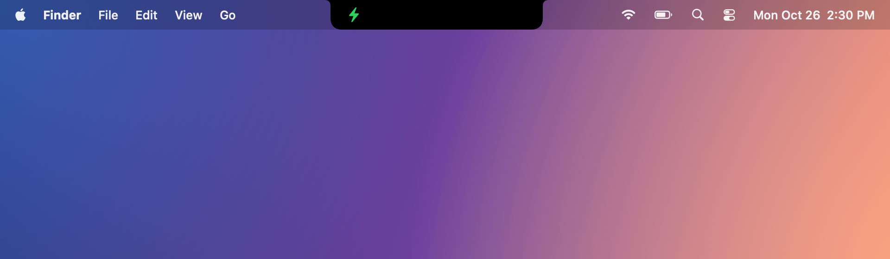
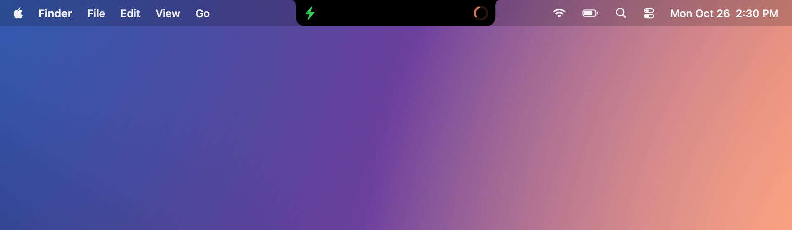

<p align="center">
  
</p>

<h1 align="center">Islet</h1>

<p align="center">
  <strong>The Dynamic Island. Reimagined for the Mac.</strong><br>
  Your music, your calls, your AI, your day. Alive in the notch.
</p>

<p align="center">
  <a href="https://github.com/tdecort/Islet/releases/latest/download/Islet.dmg"></a>
</p>

<p align="center">
  Free and open source · macOS 14 or later · Apple silicon and Intel<br>
  <a href="#install-in-one-minute">Install in one minute</a> · <a href="https://github.com/tdecort/Islet/stargazers"></a>
</p>

<p align="center">
  
  
</p>

---

## Meet Islet

That black notch at the top of your MacBook has always just been there. Islet gives it a purpose.

The song you're playing. The call you're on. What your AI is building. Your next meeting. The file you want to keep at hand. Islet shows what matters, exactly when it matters, then gets out of the way.

Every expansion, every collapse, every transition runs on spring physics tuned to feel like the Dynamic Island on iPhone. Nothing pops. Nothing jumps. It simply flows.

## Feel


Hover over the notch and the island swells, then settles back with a gentle bounce. Just like tapping an empty Dynamic Island on iPhone.

Islet measures the real notch of your Mac, so it fits a MacBook Air and a MacBook Pro alike.

## Now Playing


Album art on one side of the camera. A live visualizer, tinted with the artwork's colors, on the other.


Click for the full player: scrub, play, pause, skip, shuffle. Apple Music, Spotify and YouTube in your browser, complete with the video's thumbnail. Pause, and the island quietly steps aside.

## Your AI, live in your notch


When Claude Code is working, a progress bubble appears right next to your music. Two live activities, side by side, just like on iPhone.


Open it to see exactly what Claude is doing: thinking, running a command, editing a file. How long it has been at it. And where you stand on your session and weekly limits.


Working in another app? Islet tells you the moment Claude is done, or when it needs your answer. Stop babysitting the terminal.


**Codex, Gemini and Antigravity, too.** Use more than one assistant? They line up together, each with what it's doing and for how long. Use only Gemini, and Gemini takes the stage. An assistant appears only while it works, and steps aside a minute after.

## Calls


On a call in FaceTime, Zoom, Teams, WhatsApp, Discord, Slack or Skype, the duration and your microphone stay in view.


Click to see the other person's video, with a real **Mute** button.


**Pin the video**, and it stays with you while you work in any other app.

## Volume and brightness, reinvented


Your volume and brightness keys light up the notch instead of the old macOS overlay. Pick your look: White, Accent or **Glow**.

## Focus


Turn on a Focus and its symbol lights up in its own color. Turn it off and it fades to gray.

## Power and devices




Plugged in? A small green bolt sits quietly beside the camera, and shares the stage with whatever else is running.


Your AirPods connect, and the island shows it, battery included.


Charger in, battery low, Low Power Mode on: the essentials, at the right moment.


And a little lock that springs open when you unlock your Mac.

## Your day


Your next meetings, at a glance. From Apple Calendar, **Google Calendar**, or both.


A gentle heads-up a few minutes before each event starts.


Today's weather and the next five days, wherever you are.

## Focus timer


A timer that lives in your notch. Click the time and type any length. When it ends, the iPhone ringtone plays until you touch the island.

## Drag, drop, share


Drag a file toward the notch and it opens up to welcome it.


Keep files on **the Shelf**, then drag them right back out into Messages, Mail or anywhere else. Or drop them on **AirDrop** to send them on their way.

## Everything, without opening anything


Hover the island and swipe with two fingers: music, AI, calendar, weather, timer and Shelf glide by in compact form. Put them in the order you like, and hide the ones you don't need.

## For Macs without a notch


On an external display, Islet becomes a floating island just below the menu bar, like on iPhone.

## Designed for macOS


- **Settings that feel like System Settings.** Every option, and every permission, in one place.
- **Native and featherweight.** Written in Swift. About 70 MB of memory, 0% CPU at rest.
- **Private by design.** No account, no analytics. Islet collects nothing.
- **One click away.** Click any view to open the app behind it.

---

## Install in one minute

**1. Download.** Get [**Islet.dmg**](https://github.com/tdecort/Islet/releases/latest/download/Islet.dmg) and open it.

**2. Drag Islet onto Applications.** Then eject the disk and open Islet from your **Applications** folder.

**3. Allow it once.** The first time, macOS says it can't check Islet for malicious software. That's expected: Islet is free and open source, and not sold through Apple. Click **Done**, open **System Settings › Privacy & Security**, scroll down and click **Open Anyway**. macOS won't ask again.

**4. Turn on what you love.** Islet opens its **Permissions** page for you. Click **Allow…** next to each feature you want, and whenever macOS offers **Always Allow**, choose it. You only do this once.

That's it. Islet lives in your notch and your menu bar, never in the Dock. To start it with your Mac, turn on **Settings › General › Open at login**.

<details>
<summary><strong>What each permission is for</strong></summary>

<br>

| Permission | What it unlocks |
|---|---|
| **Accessibility** | Islet's volume and brightness overlay, and the call window kept ready for its video. |
| **Screen Recording** | The other person's video, inside the island. Islet only ever captures the call window. Islet restarts once to apply it. |
| **Calendar** | Your upcoming events and reminders. |
| **Location** | Local weather. Or type a city in Settings › Weather instead. |
| **Bluetooth** | AirPods and other devices, with battery levels. |
| **Automation** | What's playing in Music and Spotify. |
| **Full Disk Access** | Focus and Do Not Disturb. Add Islet yourself in System Settings › Privacy & Security › Full Disk Access. |
| **Keychain** *(Claude only)* | Your Claude usage limits. Choose **Always Allow**. |

</details>

### Make it yours

- **Claude Code.** Open **Settings › AI Assistants**, click **Install**, then restart Claude Code.
- **Codex, Gemini and Antigravity.** Turn them on in the same page. Nothing to install.
- **Google Calendar.** In **Settings › Calendar**, click **Sign in with Google…** and add your account in macOS. Your password stays with Apple.
- **Your pages.** Reorder or hide them in **Settings › General › Pages**.

<details>
<summary><strong>Something not working?</strong></summary>

<br>

- **macOS asks to allow Islet every time.** Make sure you open it from Applications, not from the disk image or Downloads. Still asking? Run this once in Terminal:

  ```bash
  xattr -dr com.apple.quarantine /Applications/Islet.app
  ```

- **After updating Islet, the old volume overlay is back.** Open **Settings › Permissions** and click **Allow…** next to Accessibility. A new version needs its permissions granted again.
- **Claude's limits are missing.** They're live with Claude Code in the terminal. In the Claude app, they refresh after each reply.

</details>

## Gestures

| Gesture | What happens |
|---|---|
| Hover the notch | The island bounces, or lifts when something is running. |
| Click | Opens the island. |
| Two-finger swipe ← → | Switches between activities and views. |
| Two-finger swipe ↓ / ↑ | Opens / closes the island. |
| Drag a file to the notch | Opens the Shelf and AirDrop. |
| Click the side bubble | Brings the second activity to the front. |

## Privacy

Islet has no account and collects nothing. It only goes online to fetch the weather from [Open-Meteo](https://open-meteo.com), find artwork for what you're playing, and read your Claude usage from Anthropic. Codex, Gemini and Antigravity are read from your Mac and never leave it.

<details>
<summary><strong>Build from source</strong></summary>

<br>

You need Apple's Command Line Tools (`xcode-select --install`). Then:

```bash
git clone https://github.com/tdecort/Islet.git && cd Islet
scripts/build-app.sh
mv build/Islet.app /Applications/ && open /Applications/Islet.app
```

Islet is written in Swift, SwiftUI and AppKit, with no third-party dependencies. `scripts/test.sh` runs the tests, and `scripts/create-dmg.sh` packages the disk image.

</details>

---

<h2 align="center">⭐ Love Islet? Give it a star.</h2>

<p align="center">
  If Islet made your notch worth looking at, a star takes one click.<br>
  It helps more Mac users discover Islet, and it tells us what to build next.
</p>

<p align="center">
  <a href="https://github.com/tdecort/Islet/stargazers"></a>
</p>
